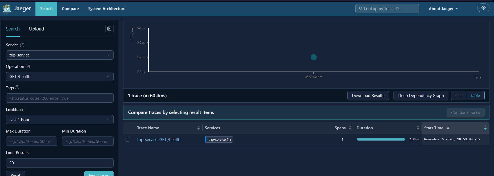
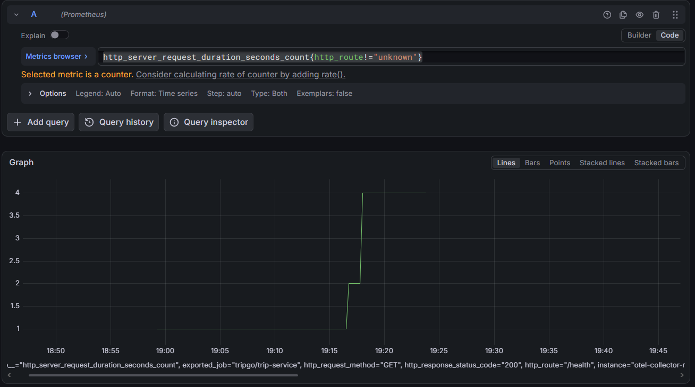
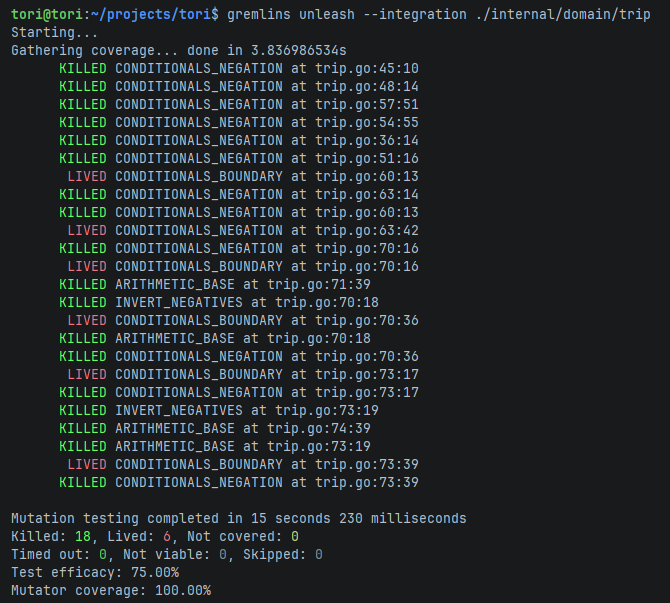
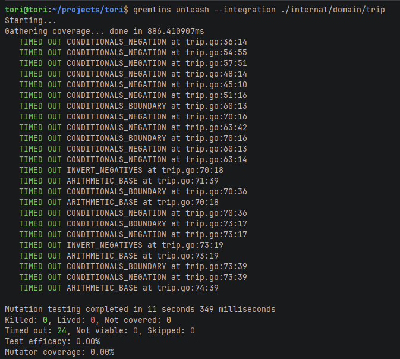
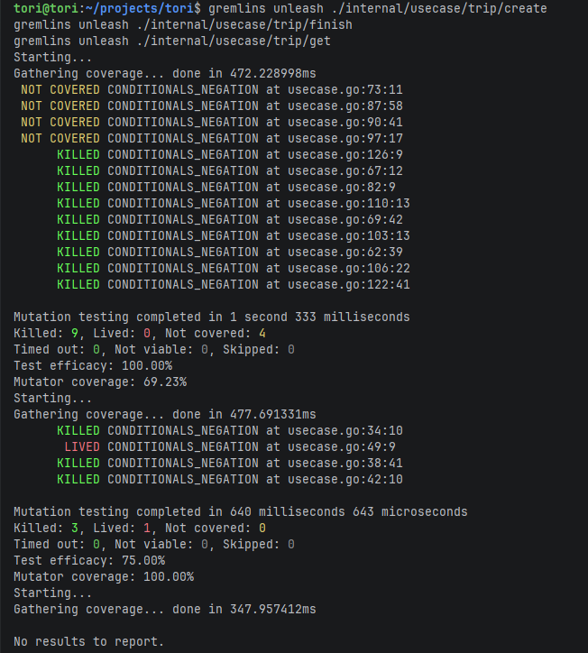

# Trip Service

HTTP-микросервис поездок на Go. Принимает запросы по OpenAPI-контракту
`contracts/openapi/trip-service.openapi.yaml`, хранит данные в PostgreSQL,
поддерживает идемпотентность `POST /api/v1/trips` по заголовку `Idempotency-Key`.

## Требования

- Go **1.26+**
- Docker (для локального окружения)
- `tripgoctl` (утилита курса) — поднимает PostgreSQL
- `psql` — опционально, для отладки БД
- `golangci-lint` — опционально, для линта

## Быстрый старт

```bash
# 1) поднять окружение (PostgreSQL в Docker)
tripgoctl cluster start
tripgoctl environment start
tripgoctl connect

# 2) накатить миграции
make migrate

# 3) запустить сервис
make run

# 4) проверить готовность
curl -sS localhost:8080/health | jq
curl -sS localhost:8080/ready  | jq
```

## Архитектура

Код строго разделён на слои, зависимости направлены внутрь (от транспорта к домену). Внешние зависимости скрыты за интерфейсами.

```
cmd/
  service/main.go       Точка входа: собирает конфиг, зовёт container.New, запускает сервер.
internal/
  config/               Разбор и валидация env.
  container/            Composition root. Создаёт пул БД, репозитории, юзкейсы, хендлеры.
  domain/               
    trip/               Ядро. Модель Trip, переходы статусов (Finish), доменные ошибки.
  model/                DTO, которые ходят между слоями (конвертация Domain <-> Model).
  usecase/              
    trip/create/        Сценарий создания (транзакции, идемпотентность).
    trip/get/           Сценарий получения.
    trip/finish/        Сценарий завершения.
  http/                 Транспортный слой.
    trip/               Хендлеры (create, get, finish), каждый в своём пакете.
    domainerror/        Единый маппинг: доменная ошибка -> HTTP Problem (RFC 9457).
    middleware/         Recover, Tracing (OTel), Logging (slog).
  repository/           
    trip/               Репозиторий поездок (squirrel + pgx).
    idempotency/        Репозиторий ключей идемпотентности.
  infra/
    postgres/           Пул pgx (с трейсингом otelpgx).
    postgres/transaction/ Менеджер транзакций (Do).
    telemetry/          Инициализация OTel SDK и slog-хендлера с trace_id.
```

### Где объявлены интерфейсы и почему

Внешние зависимости (БД, транзакции) в юзкейсах описаны **узкими интерфейсами в `contract.go`** на стороне потребителя (в `internal/usecase/trip/*`).  
**Почему:** Usecase формулирует, что ему нужно (например, только `Save` и `Get`), и не зависит от `pgx` или деталей реализации репозитория. Это позволяет легко мокать зависимости в тестах через `mockgen`.

### Правила зависимостей (проверяется `depguard`)
- `internal/domain` не импортирует `net/http`, `pgx`, `chi`, `otel`.
- `internal/usecase` не импортирует транспорт и драйверы БД.
- `internal/http` не импортирует реализацию репозиториев (`internal/repository`).

## Телеметрия (Observability)

Сервис собирает три сигнала через OpenTelemetry (экспорт по OTLP в локальный коллектор).

### 1. Трейсы
- **HTTP-запросы:** middleware `otelhttp` создаёт корневой спан.
- **Запросы в БД:** библиотека `otelpgx` создаёт вложенные спаны.
- **Имя спана:** `{method} {http.route}` (шаблон маршрута, например, `POST /api/v1/trips`).

**Jaeger:** Создание поездки (виден HTTP-запрос и вложенный спан БД)  


### 2. Метрики

Собираются в Prometheus, визуализируются в Grafana.

**HTTP-метрики и бизнес-метрики (`http_server_request_duration`, `tripgo_trips_created_total`)**  


### 3. Логи

Пишутся в JSON через `log/slog`. В каждой записи внутри спана автоматически проставляются `trace_id` и `span_id` через кастомный `telemetry.TraceHandler`.


```json
{"time":"...","level":"INFO","msg":"request handled","method":"GET","route":"/health","status":200,"duration_ms":0,"trace_id":"4aed1e...","span_id":"0c3892..."}
```

## Тестирование

```bash
make test              # Unit-тесты с -race и покрытием
make test-integration  # Интеграционные тесты с реальным PostgreSQL
make lint              # Проверка линтером
```
- Покрытие `internal/domain` — 84.6%, `internal/usecase` — 72-100%.
- Моки сгенерированы через `mockgen` (директивы `go:generate`).
- Интеграционные тесты изолированы (очищают таблицы перед запуском).


### Мутационное тестирование

В `internal/domain` и `internal/usecase` прогнан `gremlins`.

**Domain (до добавления тестов на границы):**  


**Domain (после добавления `TestTrip_Validate_Boundaries`):**  


**Usecase (Create, Finish, Get):**  


## API

Источник — `contracts/openapi/trip-service.openapi.yaml`. Реализованы:

| Метод  | Путь                            | Ответы                 |
|--------|---------------------------------|------------------------|
| `POST` | `/api/v1/trips`                 | 201, 400, 409, 500     |
| `GET`  | `/api/v1/trips/{tripId}`        | 200, 400, 404, 500     |
| `POST` | `/api/v1/trips/{tripId}/finish` | 200, 400, 404, 409, 500|
| `GET`  | `/health`                       | 200                    |
| `GET`  | `/ready`                        | 200, 503               |

Ошибки отдаются в `application/problem+json` (RFC 9457) с расширением `code`.

### Примеры

```bash
# создание
curl -sS -X POST localhost:8080/api/v1/trips \
  -H 'content-type: application/json' \
  -d '{"user_id":"5cb72c04-7650-45c9-a79b-bcdba0631e0c",
       "driver_id":"8860b315-ec86-42eb-a17c-7c163d721ff5",
       "start_point":{"latitude":59.9398,"longitude":30.3146},
       "end_point":{"latitude":59.9290,"longitude":30.3626},
       "price":1450}'
# получение
curl -sS localhost:8080/api/v1/trips/$TRIP_ID | jq
# завершение
curl -sS -X POST localhost:8080/api/v1/trips/$TRIP_ID/finish | jq
```

## Ключевые решения (БД и транзакции)

### Уровень изоляции — `READ COMMITTED`

Корректность бизнес-правил держится **не изоляцией**, а явными механизмами:
- запрет двух активных поездок — **частичным уникальным индексом**;
- двойное завершение — **условным `UPDATE`** с проверкой статуса в `WHERE`.

### Менеджер транзакций

Интерфейс `TxManager` (`Do`) открывает транзакцию через `pool.BeginTx`, кладёт её в `context` и вызывает `fn`. При ошибке делает `ROLLBACK`.  
Репозитории не принимают транзакцию аргументом, они достают её из контекста через `Querier(ctx)`.

### Идемпотентность `POST /api/v1/trips`
- Первый с ключом: `201`, поездка создана.
- Повтор с тем же ключом и телом: `200`, та же поездка.
- Тот же ключ, другое тело: `409 idempotency_conflict`.  
  Сравнение тела — по SHA-256 канонизированного JSON. Транзакция пишет в 3 таблицы (ключи, поездки, история).

## Переменные окружения

Все параметры читаются из env (см. `.env.example`). Реальный `.env` генерируется `tripgoctl` и не коммитится.  
Добавлены переменные для телеметрии: `OTEL_SERVICE_NAME`, `OTEL_EXPORTER_OTLP_ENDPOINT`, `OTEL_EXPORTER_OTLP_PROTOCOL` и др.

## Makefile

| Цель                    | Что делает                                 |
| ----------------------- | ------------------------------------------ |
| `make generate`         | Генерирует OpenAPI код                     |
| `make migrate`          | Накатывает миграции                        |
| `make run`              | Запускает сервис                           |
| `make test`             | Запускает unit-тесты с `-race` и покрытием |
| `make test-integration` | Запускает интеграционные тесты с БД        |
| `make lint`             | Запускает `golangci-lint`                  |

## Проверка

### Гонка create — 20 параллельных на одного водителя

```bash
DRIVER=$(cat /proc/sys/kernel/random/uuid)
cat > /tmp/trip_race.json <<EOF
{"user_id":"5cb72c04-7650-45c9-a79b-bcdba0631e0c",
 "driver_id":"$DRIVER",
 "start_point":{"latitude":59.9398,"longitude":30.3146},
 "end_point":{"latitude":59.9290,"longitude":30.3626},
 "price":1450}
EOF

seq 20 | xargs -P20 -I{} curl -s -o /dev/null -w '%{http_code}\n' \
  -X POST localhost:8080/api/v1/trips \
  -H 'content-type: application/json' -d @/tmp/trip_race.json \
  | sort | uniq -c
```

Ожидаешь: `1×201 + 19×409`.

### Гонка finish — 2 параллельных

```bash
TRIP_ID=$(curl -sS -X POST localhost:8080/api/v1/trips \
  -H 'content-type: application/json' \
  -d '{"user_id":"5cb72c04-7650-45c9-a79b-bcdba0631e0c","driver_id":"'$(cat /proc/sys/kernel/random/uuid)'","start_point":{"latitude":1,"longitude":1},"end_point":{"latitude":2,"longitude":2},"price":100}' \
  | jq -r .id)

( curl -s -o /dev/null -w 'A:%{http_code}\n' -X POST localhost:8080/api/v1/trips/$TRIP_ID/finish & \
  curl -s -o /dev/null -w 'B:%{http_code}\n' -X POST localhost:8080/api/v1/trips/$TRIP_ID/finish & \
  wait )
```

Ожидаешь: один `200`, один `409`.

### Идемпотентность

```bash
KEY=$(cat /proc/sys/kernel/random/uuid)
DRIVER=$(cat /proc/sys/kernel/random/uuid)
BODY="{\"user_id\":\"5cb72c04-7650-45c9-a79b-bcdba0631e0c\",\"driver_id\":\"$DRIVER\",\"start_point\":{\"latitude\":1,\"longitude\":1},\"end_point\":{\"latitude\":2,\"longitude\":2},\"price\":100}"

# 201
curl -sS -X POST localhost:8080/api/v1/trips -H 'content-type: application/json' -H "Idempotency-Key: $KEY" -d "$BODY" | jq .id

# 200, тот же id
curl -sS -X POST localhost:8080/api/v1/trips -H 'content-type: application/json' -H "Idempotency-Key: $KEY" -d "$BODY" | jq .id
```

### `/ready` при недоступной БД

```bash
tripgoctl environment stop
curl -i -sS localhost:8080/ready    # 503
curl -i -sS localhost:8080/health   # 200
tripgoctl environment start
curl -i -sS localhost:8080/ready    # 200
```

## Откат миграций

```bash
make migrate-down   # откатит последнюю
make migrate-status # проверить
make migrate        # накатить заново
```